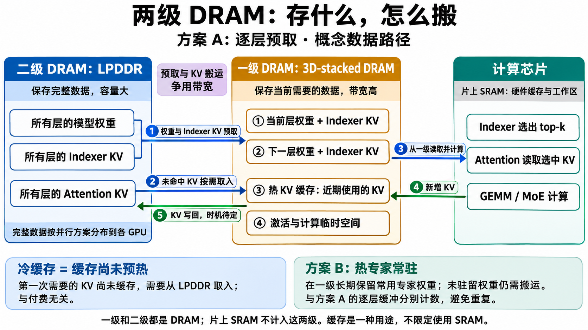
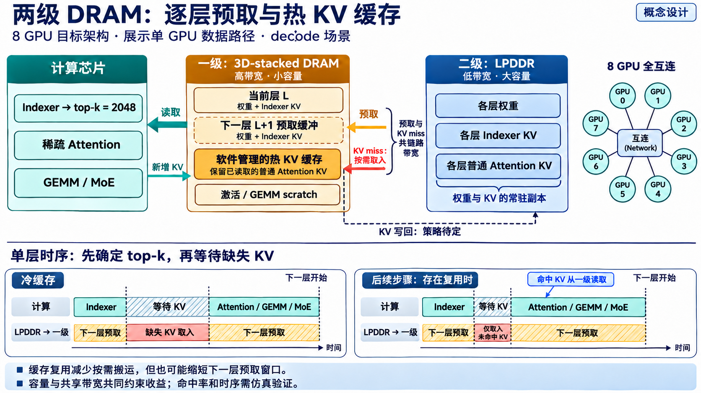
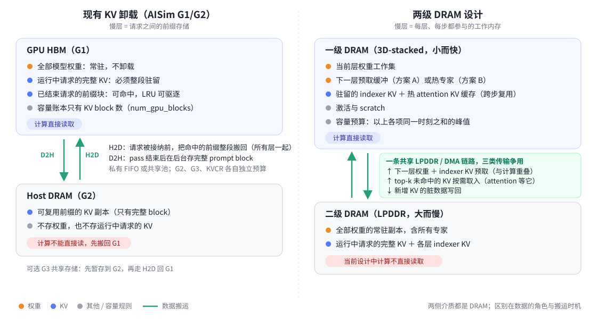
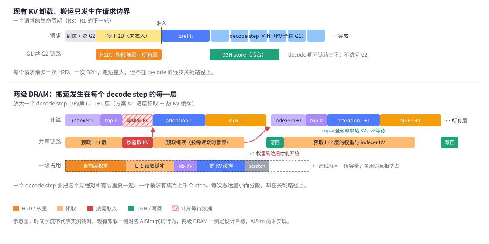

## Baseline AI-SIM KV Cache 可视化

### 实现

AISim 运行时自带 `run_replay_with_artifacts_json`。它与 CLI 默认调用的 `run_replay_json` 共用同一个 replay 循环，额外返回以下数据：

- `kv_events`：G1 与 G2（`host_pinned`）中 block 的可见和移除。
- `host_offload_events`：`store_prepared`、`store_submitted`、`store_completed`、`load_queued`、`load_completed`、`evicted`，带 `completes_at_ms`。

### 效果



注：
- R1：hash [1,2,3]。
- R2：hash [11,12,13]，用来挤掉 R1 在 G1 的前缀。
- R3：**R1 的下一轮**。输入 = R1 的 9 个 prompt token + 1 个输出 token + 2 个新 token = 12 token，hash [1,2,30]：与 R1 共享前 2 个整块，第 3 块含本轮新内容，是新 block。
- R4：hash [21,22,23]。

## 二级 DRAM 场景

### 场景介绍

### 参数

| 项目                                    | BS=8，GPU=1，256K | BS=1，GPU=1，256K | BS=8，GPU=1，1M | BS=144，GPU=8，1M |
| ------------------------------------- | --------------: | --------------: | ------------: | --------------: |
| Total Expert Routed Weights           |            90.1 |            11.3 |          90.1 |             720 |
| Hot Expert (70%)                      |              63 |             7.9 |            63 |             505 |
| Cold Expert (20%)                     |              18 |            2.25 |            18 |             144 |
| KV Cache                              |             9.6 |             1.2 |          38.5 |             692 |
| Hot KV Cache，HCA + indexer + top-k KV |            2.12 |            0.27 |          8.47 |             153 |
| Level1 Memory per card，原表结果           |            74.3 |              19 |            83 |              84 |
| Level2 Memory per card，原表结果           |             741 |             733 |           770 |             178 |
### 实现

### 初步效果



### 下一步

| 配置  | 冷启动 ms | 缓存满后 ms/token |  计算 | 等非专家权重 | 等专家 | 搬运 GB/token | 链路利用率 |
| --- | -----: | ------------: | --: | -----: | --: | ----------: | ----: |
|     |        |               |     |        |     |             |       |
|     |        |               |     |        |     |             |       |
