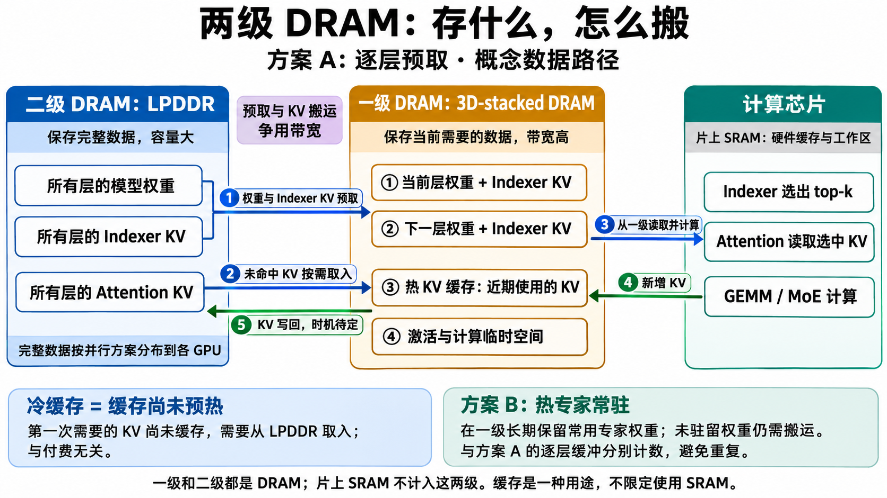

---
author:
  - Codex
  - Claude
title: "[Agent] 初期目标：两级 DRAM 下的预取与热 KV 缓存"
description: 两级 DRAM 的数据放置、容量预算与 AISim 回放结果：36 GB 下非专家权重轮换主导，96 GB 下专家搬运主导。
date: 2026-11-23T00:07:53+08:00
lastmod: 2026-11-25T10:42:08.278+08:00
content_lang: zh-CN
draft: true
weight: 0
---

## 目标与当前结论

在 AISim 中建立两级 DRAM 的 decode 模型，研究逐层权重预取、跨步专家缓存和热 KV 缓存。一级为高带宽、小容量的 3D-stacked DRAM，二级为 LPDDR；目标部署为 8 GPU，当前扩展只回放单 GPU 的逐层访问。

现有实验中，36 GB 一级配置的时延主要来自非专家权重轮换；96 GB 配置可将这些权重常驻，主要等待转为专家搬运。理想复制带宽为 2.2 TB/s 时，两者后期时延分别约为 15.6 和 4.7 ms/token，96 GB 场景尚未达到设定的稳定判据。

跨步专家 LRU 缓存降低了重复搬运。按上一步路由预取专家，在有缓存时没有触发，在逐层释放专家时增加了流量和时延。当前工作负载中，热 top-k KV 缓存只节省约 0.005 ms/token。

这些结果来自放宽二级容量检查的反事实实验：权重与 KV 共需 806.6 GB，超过单卡 LPDDR 的 128 GB 默认容量和 512 GB 最大选项。实验使用合成路由及未经实测校准的 EXI roofline 计算时间，用于比较策略；多卡分片与实际复制带宽仍需确定。

## 数据放置与执行路径

方案 A 的设计如下：LPDDR 保存权重和 KV 的完整副本，一级保存工作集、缓存和 scratch。8 GPU 部署中的完整副本指整个部署的总量，每卡占用取决于分片方式。片上 SRAM 不计入两级 DRAM 容量。

| 对象 | 放置与访问方式 |
| --- | --- |
| 各层权重，包括 MoE 专家权重 | LPDDR 保存常驻副本；一级 DRAM 容纳当前层工作集，并预取下一层权重。专家预取范围与路由时机后续明确 |
| Indexer KV | LPDDR 保存各层数据；随下一层权重一起预取到一级 DRAM |
| 普通注意力 KV | LPDDR 保存完整数据；indexer 选出 top-k 后，未命中的 KV 按需取入一级 DRAM |
| 热 KV 缓存 | 一级 DRAM 中的软件管理缓存，保留已取入的 KV 供后续 decode step 复用；预留额外 token 槽位 |
| 激活与 GEMM 临时数据 | 使用一级 DRAM scratch 空间，在模型中不写入 LPDDR |

每层先执行 indexer，再将选中的缺失 KV 搬入一级，attention 等待数据到达。下一层权重和 indexer KV 可在当前层计算时预取；预取、按需读取与写回共用复制链路。

时序图表示依赖关系，长度不表示耗时。热 KV 缓存保留跨 decode step 可复用的副本；首次取入算未命中，收益取决于后续 top-k 重合度和淘汰策略。新增 KV 在一级生成后回写 LPDDR。

容量估算设定 top-k = 2048；本次回放采用 AISim DeepSeek-V4-Pro 配置的 `index_topk = 1024`。两者需要分开比较。

### 权重轮换与跨步专家缓存

非专家权重的驻留策略和专家缓存策略分别配置。36 GB 场景逐层轮换非专家权重，96 GB 场景将其常驻；两者默认都对路由专家使用跨步 LRU。

| 比较项 | 方案 A：逐层预取 | 方案 B：热专家常驻 |
| --- | --- | --- |
| 一级权重空间 | 当前层工作集与下一层预取缓冲 | 跨层热专家集合，加未驻留权重的工作缓冲 |
| 释放时机 | 当前层用完后回收或轮换 | 随缓存策略淘汰，不按每层结束统一释放 |
| 主要收益 | 用当前层计算时间隐藏下一层搬运 | 对常驻专家的重复访问省去 LPDDR 搬运 |
| 主要约束 | 预取窗口、缓冲容量与传输带宽 | 热专家集合大小、路由变化和剩余缓冲空间 |

专家以“层编号、专家编号”标识，同一驻留副本只计一次容量。LRU 在缓存未满时积累专家，满后淘汰，使用中和传输中的专家受到保护。逐层释放则在使用结束后回收专家，不保留跨步复用。

一级峰值预算同时包含驻留权重、当前层与预取缓冲、专家缓存、KV、scratch 和运行时缓冲。缓存占用满额时，内容仍可随淘汰而更换。

## 设计容量表

下表估算 V4 Pro 在 256K 和 1M 上下文中的内存需求，一级采用 96 GB，数值单位为 GB；BS 的全局／每卡口径尚未说明。

| 项目                                    | BS=8，GPU=1，256K | BS=1，GPU=1，256K | BS=8，GPU=1，1M | BS=144，GPU=8，1M |
| ------------------------------------- | --------------: | --------------: | ------------: | --------------: |
| Total Expert Routed Weights           |            90.1 |            11.3 |          90.1 |             720 |
| Hot Expert (70%)                      |              63 |             7.9 |            63 |             505 |
| Cold Expert (20%)                     |              18 |            2.25 |            18 |             144 |
| KV Cache                              |             9.6 |             1.2 |          38.5 |             692 |
| Hot KV Cache，HCA + indexer + top-k KV |            2.12 |            0.27 |          8.47 |             153 |
| Level1 Memory per card，估算值           |            74.3 |              19 |            83 |              84 |
| Level2 Memory per card，估算值           |             741 |             733 |           770 |             178 |

二级按 732 GB 模型加完整 KV 计算。四列直接复算为 741.6、733.2、770.5、178 GB；最后一列使用 `(732 + 692) / 8`，前提是权重和 KV 均匀分片且没有额外副本。

8 GPU 列中，Hot Expert 与 Hot KV 合计 82.25 GB/卡，表内其余权重约 1.75 GB/卡。96 GB 与表内 84 GB 相差 12 GB，运行时还需核对预取缓冲、激活、scratch 和通信缓冲是否包含在内。

上述估算尚缺少几项计算依据：732 GB 的权重组成与量化元数据；Hot 70% 和 Cold 20% 的分母及剩余 10%；HCA、Indexer KV 与 top-k KV 是否重叠；各项分片和复制方式。Routed Weights 也需区分唯一驻留字节与累计访问量。表中 GPU 数和 BS 同时变化，无法单独衡量增加 GPU 的容量收益。

## AISim 扩展

AISim 原有 G1/G2 卸载在请求接纳时加载可复用的 KV 前缀。两级 DRAM 模型还需要在 decode 的每一层记录权重驻留、选中 KV、传输依赖和共享链路排队，单改 G1/G2 参数不足以表达这些行为。

上述对比对应 AISim 的主机前缀卸载路径。实现参考为 `host_offload/tier.rs`、`scheduler/vllm/host_offload.rs` 和 `offload_transfer.rs`；DSV4 的 top-k 计算位于 `perfmodel/perf_database/dsv4.rs`。

实现位于 `src/two-tier-dram`。扩展通过 entry point 注册 stack `two_tier_dram`，使用 `aisim predict --stack two_tier_dram` 运行，用法见组件 README。

### 硬件输入

| 参数 | 模型配置 | 取值说明 |
| --- | --- | --- |
| 一级容量 | 36 GB | 基准预设 |
| 一级读带宽（计算读一级） | 18 TB/s | 基准预设（3D DRAM） |
| 二级容量 | 128 GB | 预设默认值；范围 64–512 GB |
| 二级标称带宽 | 2.2 TB/s（对照 1.1 TB/s） | LPDDR6 参数区间 1.1–2.2 TB/s |
| 复制效率（有效复制带宽 = 二级标称带宽 × 效率） | 1.0（对照 0.7） | 实验假设 |
| 每次传输固定开销 | 0（扫描 1、10、100 µs） | 实验假设 |
| 卡间带宽 | 1.6 TB/s，双向合计 | 未确认的参数，单卡模型不使用 |
| 计算峰值 | FP8 2.95 PF、FP4 6.13 PF（675 W） | 基准预设 |
| scratch | 4 GB | 假设 |

四类带宽分别配置；带单位的输入在入口换算为 bytes、bytes/s 和 seconds。GB 与 GiB、TB/s 与 Tb/s 分开解析。96 GB 一级使用独立预设 `exi_96gb_explore`。`>24 TB/s` 与 `150 GB+ per Compute Tile` 均为未确认的参数，未用于实验。

EXI-SOL 使用 AISim 逐算子的计算／访存 roofline。本次单请求 decode 的非零算子时间受内存带宽限制，相对 B200 的比例为 18 / 7.7。另保留 B200 计算配合两级内存的混合对照。

### 模型与容量预算

回放采用 `deepseek-ai/DeepSeek-V4-Pro`，路由专家量化模式为 `w4a8_mxfp4_mxfp8`。产物中的权重为 805.685 GB，其中路由专家约 773.698 GB，非专家权重约 31.987 GB；200K 上下文 KV 为 0.910 GB，二级总需求约 806.6 GB。旧实验采用 FP8 版本，记录的权重约 1579 GB。容量估算中的 732 GB 与本次模型清单尚未逐项对齐，不能只凭量化位宽解释差额。

36 GB 一级中，31.987 GB 非专家权重加 4 GB scratch 已占约 35.987 GB。另需约 0.125 GB 常驻 KV，以及至少 0.198 GB 的一层路由专家，因此全部常驻配置失败。当前对照采用逐层轮换非专家权重；96 GB 配置可容纳它们常驻。

二级容量检查默认拒绝该单卡配置。下列策略实验显式设置 `counterfactual`，继续计算容量放宽后的时序。

### 行为回放

页面包含 EXI 36 GB、96 GB 探索、B200 混合和旧假设四个回放场景，以及 40 个运行条目，其中两项为容量失败检查。EXI 动画各回放 16 步，主要参数对照各运行 32 步。页面显示各项参数与假设、缓存占用／上限、淘汰数、逐步命中率和阶段。



## 对照结果

主要对照使用单请求、200,000 token 上下文、32 个 decode step、随机种子 0、专家跨步重合度 0.5、top-k 重合度 0.75，以及 EXI-SOL 计算。专家每层选 6 个，top-k 为 1024。

表中“稳态”指回放器判定的末 6 步波动不超过 5%；满足时取该窗口均值，否则取缓存进入淘汰阶段后的均值，并列出波动。16 步动画与 32 步对照的统计窗口不同。

| 配置                         | 冷启动 ms |   缓存满后 ms/token |   计算 | 等非专家权重 | 等专家 | 搬运 GB/token | 链路利用率 |
| -------------------------- | -----: | --------------: | ---: | -----: | --: | ----------: | ----: |
| 36 GB · 2.2 TB/s 理想        |   18.5 |        15.6（稳态） | 2.13 |   10.8 | 2.7 |        34.2 |  100% |
| 36 GB · 1.1 TB/s 理想        |   36.9 |        31.2（稳态） | 2.13 |   23.7 | 5.4 |        34.3 |  100% |
| 36 GB · 2.2 TB/s × 0.7（假设） |   26.4 |        22.3（稳态） | 2.13 |   16.3 | 3.8 |        34.3 |  100% |
| 96 GB · 2.2 TB/s 理想        |    7.6 | 4.7（未稳态，波动 13%） | 2.13 |      0 | 2.5 |         5.6 |   54% |
| 96 GB · 1.1 TB/s 理想        |   13.1 | 7.2（未稳态，波动 16%） | 2.13 |      0 | 5.1 |         5.6 |   70% |

| 对照（2.2 TB/s 理想为基准） | 36 GB ms/token | 96 GB ms/token |
| --- | ---: | ---: |
| 基准 | 15.6 | 4.7 |
| 每次传输开销 1 / 10 / 100 µs | 15.7 / 17.1 / 30.6 | 4.8 / 5.6 / 13.6 |
| 专家逐层释放（无跨步缓存） | 18.4 | 7.6 |
| 逐层释放 + 按上一步路由预取 | 21.0 | 8.1 |
| 有 LRU 缓存时按上一步路由预取 | 15.6（0 次触发） | 4.7（0 次触发） |
| 关闭热 top-k KV | 15.6 | 4.7 |
| 专家重合度 0.25 / 0.75 / 0.9 | 16.9 / 14.3 / 13.4 | 5.9 / 3.5 / 2.7 |
| B200 计算（混合） | 15.7 | 7.6 |

36 GB 的 32 步对照中，每 token 搬运约 34.25 GB，除以 2.2 TB/s 得到 15.57 ms，与模拟的 15.59 ms 接近，链路几乎全程忙碌。96 GB 下约为 2.13 ms 计算加 2.54 ms 专家等待；KV 等其他传输占比很小。

### 容量决定主要等待来源

36 GB 下，非专家权重轮换占搬运量约 83%，每 token 等待约 10.8 ms，专家等待约 2.7 ms。96 GB 下非专家权重常驻，专家等待约占时延的 54%。此前“专家搬运主导”的结论只适用于后一种配置。

跨步 LRU 在本次实验中减少了专家搬运。改为逐层释放后，36 GB 和 96 GB 的时延分别增加约 18% 和 63%。96 GB 下将合成专家重合度从 0.25 提高到 0.9，时延从 5.9 降至 2.7 ms/token。

### 当前预取策略的收益受限

36 GB 下，一层约 0.46 GB 的非专家权重需要约 0.21 ms 搬运，而平均每层计算约 0.033 ms，下一层预取无法完全隐藏传输。现有结果证明预取窗口不足，尚不能据此判断关闭非专家预取是否更快。

按上一步路由预取专家时，LRU 场景记录了 0 次预取；逐层释放场景的时延则从 18.4 增至 21.0 ms/token（36 GB），从 7.6 增至 8.1 ms/token（96 GB）。这套预测策略未获得收益。

### 热 KV 与固定传输开销

在当前 200K、top-k 1024、单请求工作负载中，关闭热 top-k KV 缓存仅增加约 0.005 ms/token。主瓶颈在权重搬运。

固定传输开销单独扫描：36 GB 场景从 0 增至 10 µs/次，时延增加约 1.5 ms/token；增至 100 µs/次，增加约 15 ms/token。实际开销需由硬件确认。

复制写入与计算读取对一级带宽的争用尚未建模。

## 下一步

下一阶段先确定权重与 KV 的多卡分片，建立可容纳完整模型的配置，再用真实路由统计评估缓存和预取。硬件侧需补齐有效复制带宽、每次传输开销、内部互连限制及计算是否可直接读取二级，并加入一级读写争用。96 GB 场景需延长回放，确认长期表现。

### 旧假设对照

旧配置使用 FP8 模型、B200 计算、一级 96 GB、二级 2048 GB、64 GB/s 复制带宽和 10 µs/次开销。2048 GB 是为容纳模型而设置的探索容量。下表保留旧结果，适用范围仅为这组配置。当前回放中前三步为 385.48 / 202.60 / 184.01 ms。

| 场景 | 改动 | 两级每 token (ms) | 观察 |
| --- | --- | --- | --- |
| 基线 | 无 | 385 / 203 / 184 | 专家搬运决定时延：等专家共 751 ms，等 top-k KV 仅 1.3 ms |
| 对账 | 链路 1e6 GB/s，开销 0 | 6.56 / 6.55 / 6.55 | 搬运代价趋零时回到 AISim 原生的 6.54 ms |
| 专家路由更稳定 | 专家跨步重合度 0.5 → 0.9 | 385 / 45 / 46 | 时延对路由的跨步稳定性很敏感 |
| 一级缩到 48 GB | 专家缓存 906 → 179 个位置 | 385 / 385 / 385 | 一个 step 要用 366 个专家，缓存放不下，命中 0 |
| 48 GB + 专家预取 | 按上一步路由预取 | 385 / 574 / 551 | 预取只有一半用得上，却占着关键路径上的链路，反而更慢 |
| 关闭热 top-k KV | 取入后用完即丢 | 385 / 203 / 184 | 每 token 只多 0.18 ms，KV 不是瓶颈 |
| 传输开销变大 | 每次传输 0.01 → 0.5 ms | 430 / 247 / 229 | 等 KV 从 1.3 涨到 45 ms：小而频繁的读取取决于开销 |
| 方案 A | 非专家权重逐层换入 | 823 / 640 / 621 | 182 次预取全部迟到：一层 0.46 GB 要 7.2 ms，一层计算只有 0.1 ms |
| 一级放不下 | 一级 36 GB | 运行中止 | 常驻项之后放不下一层的 6 个专家 |

## 运行依赖

树外扩展使用 AISim 环境，无需安装 Dynamo。后续采用 Dynamo Router、Planner 或 `--stack dynamo` 时再配置对应依赖。
