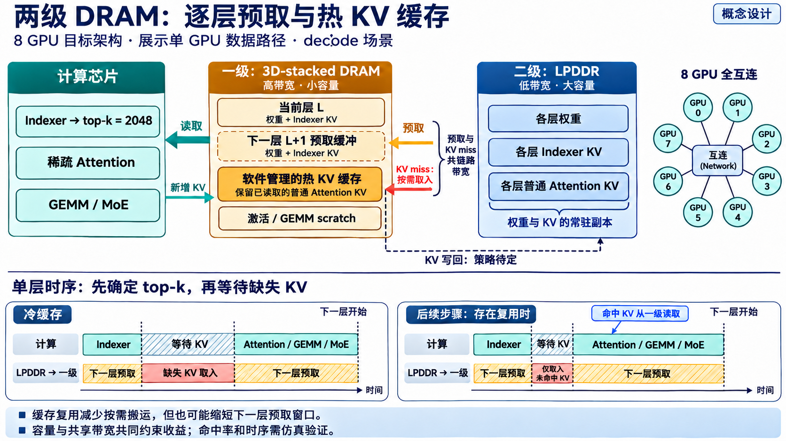
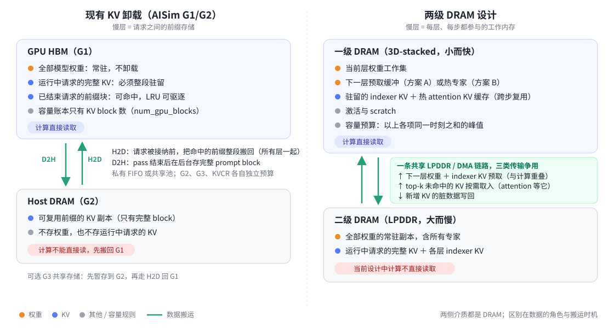
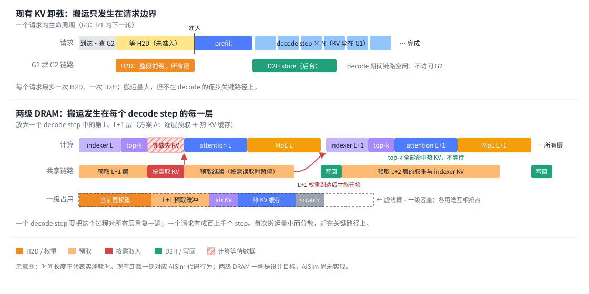

---
author:
  - Codex
  - Claude
title: "目标：用 AISim 精细化单 GPU 两级 DRAM 的容量与带宽权衡曲线"
description: 研究目的是用 AISim 以更高精度复现并细化 EXI 幻灯片中的 TPOT 曲线；记录目标曲线的数据、表格模型的隐含假设，以及当前实现与目标的差距。
date: 2026-11-23T00:07:53+08:00
lastmod: 2026-11-27T11:28:31+08:00
content_lang: zh-CN
draft: true
weight: 1
---

## 目标

用 AISim 在单 GPU 两级 DRAM 架构上重新生成 EXI 幻灯片中的三组 TPOT 曲线，并做得比原来的表格模型更精细：采样点更密，计入表格模型没有的效应，每个点都能追溯到逐层、逐次传输的仿真记录。

- **架构**：同一颗 GPU 的本地内存分两级。一级是小容量、高带宽的 DRAM（EXI-HBM 或 3D DRAM），二级是大容量、低带宽的 DRAM（LPDDR）。两级都在这颗 GPU 上，不是 GPU 加 CPU 内存。
- **硬件是设计参数**：EXI 尚无对应产品，模拟的意义正是评估这种假设设计。不要求参数来自已出货产品，但每个参数要标明出处（幻灯片、架构表或假设）。GB200 的结果属于 GPU 加 CPU 内存卸载，只作对照，不作目标架构。
- **负载**：DeepSeek-V4-Pro，batch 8，1 GPU，上下文 256K 和 1M，稳态 decode 的 TPOT。真实 Mooncake trace 用于扩展到多请求场景，不用于复现这三组曲线。
- **交付**：同坐标轴的曲线，与目标数据逐点对照，并解释每一处偏差来自哪个效应。

### 目标曲线

数据从三张幻灯片照片中读出，存为 `src/two-tier-dram-engine/targets/exi-slides.csv`（32 个点）。照片本身不保存。图上印有数字的直接采用，其余按坐标轴读数，TPOT 误差约 ±1 ms，损失率约 ±2 个百分点。

幻灯片给出的共同设定：
- 一级带宽 10 TB/s（EXI-HBM），二级为 DDR；
- 一级存放 70% 的热专家和 22% 的 KV；
- 理想 TPOT 指数据全部在一级时的 TPOT；损失率 = 1 − 理想 ÷ 实得。

带宽扫描，一级固定 96 GB（单位 ms）：

| 二级带宽（TB/s） | 0.25 | 0.5 | 0.75 | 1 | 1.25 | 1.5 | 2 | 3 | 4 |
| --- | --- | --- | --- | --- | --- | --- | --- | --- | --- |
| 1M 理想 | 19.5 | 19.5 | 19.5 | 19.5 | 19.5 | 19.5 | 19.5 | 19.5 | 19.5 |
| 1M 实得 | 90 | 54.5 | 43 | 37 | 33.5 | 31 | 28 | 25 | 23.5 |
| 1M 带重叠 | 70 | 35 | 23.5 | 19.5 | 19.5 | 19.5 | 19.5 | 19.5 | 19.5 |
| 256K 理想 | 16.7 | 16.3 | 16 | 15.7 | 15.3 | 15 | 14.7 | 14.3 | 14 |
| 256K 实得 | 87 | 51.5 | 39.5 | 33.5 | 29.5 | 26.5 | 23.5 | 20.3 | 18.3 |
| 256K 带重叠 | 70 | 34.5 | 22.5 | 16.5 | 15.3 | 15 | 14.7 | 14.3 | 14 |

容量扫描，二级 1 TB/s（单位 ms）：

| 一级容量（GB） | 36 | 48 | 64 | 96 | 128 | 256 | 512 |
| --- | --- | --- | --- | --- | --- | --- | --- |
| 256K 理想 | 16.5 | 16.3 | 16 | 15.7 | 15.4 | 15.2 | 15 |
| 256K 实得 | 74 | 62 | 46 | 33.5 | 33 | 32.8 | 32.5 |
| 1M 理想 | 19 | 18.8 | 18.5 | 18.3 | 18 | 17.8 | 17.5 |
| 1M 实得 | 82.5 | 70.5 | 55 | 36 | 36 | 35.5 | 35.5 |

幻灯片的结论：一级 96 GB 是容量的拐点；二级 1–1.5 TB/s 是带宽的合适区间；有重叠时 1 TB/s 足以把冷数据（权重和 KV）的搬运藏在计算之下。

### 表格模型的隐含假设

把数据代回去（`exi-slides.csv` 逐点验算），三组曲线几乎完全由两个量决定：

- **实得 = 理想 + C ÷ 二级带宽**。一级 96 GB 时，每步从二级搬运的量 C 在两个上下文、全部带宽下都约为 17.5 GB（16.0–18.0 GB）。
- **带重叠 = max(理想, C ÷ 二级带宽)**。18 个点里 15 个与读数相差不超过 0.5 ms；其余 3 个是 256K 的 0.5–1 TB/s，相差 0.7–1.3 ms。
- **C 随一级容量变化**：256K 下 36、48、64 GB 时为 57.5、45.7、30.0 GB；96 GB 及以上不再下降，停在约 17.5 GB，即使一级有 512 GB。
- **其他小问题**：理想 TPOT 随二级带宽和一级容量略有下降，按定义不应如此；256K 带宽图在 3、4 TB/s 处，损失率曲线比柱高算出的低 4–5 个百分点；文字写“2 TB/s 25 ms、4 TB/s 21 ms”，柱高读数为 23.5 和 18.3 ms。

以上是推断：表格模型很可能是“每步固定搬运量”加“完全串行或完全重叠”两种极端。C ≈ 17.5 GB 与原设计容量表 BS=8 一列的“Cold Expert (20%) 18 GB”基本一致，说明表格模型假设热专家（70%）常驻一级、冷专家（20%）每步都从二级搬一遍，所以一级超过 96 GB 后 C 不再下降。模拟器要检验的正是这些假设：
- 真实路由下，每步需要从二级搬的专家量是多少，是否随一级容量继续下降；
- 重叠能做到多少，介于串行与完全重叠之间的哪里；
- 链路排队、逐层依赖、prefill 插入、KV 增长对 TPOT 的影响。

### 当前实现与目标的差距

| 项目 | 目标曲线 | 当前实现 |
| --- | --- | --- |
| 一级带宽 | 10 TB/s | `exi_3ddram.yaml` 为 18 TB/s |
| 上下文 | 256K、1M | 配置中 `context_length` 为 131,072，扫描最长 32,768 |
| 负载 | batch 8 稳态 decode | 4 个错峰请求，或真实 trace 窗口 |
| 坐标轴 | 二级带宽 0.25–4 TB/s；一级 36–512 GB | 二级 1.1–4.4 TB/s；一级 24–128 GB |
| 输出指标 | TPOT 与损失率 | 完成时间、TTFT、平均 ITL |
| 重叠 | 有、无两条曲线 | 只有一种：按需取入，非专家权重可逐层预取，专家预取 `last_step` 实测无效果 |
| 专家放置 | 70% 热专家静态常驻 | LRU 或分层分区，合成路由 |
| 二级容量 | 单卡装下整个模型 | 单卡 Pro 需要 805.7 GB 二级；原设计容量表按 741–770 GB 估算 |

**二级容量（2026-11-27 确定）**：单卡复现时，二级按原设计容量表的算法取值，即权重加这批请求的全部 KV，并开启强制检查。DeepSeek-V4-Pro 单卡权重 805.7 GB，batch 8 时 256K 约需 815 GB，1M 约需 843 GB。二级容量是设计参数，这与“二级放不下时不报告结果”的规则不冲突。

### 此前的结论

- 首次模拟复现见[两级 DRAM 幻灯片曲线的首次模拟复现](../two-tier-dram-slide-curves/)：曲线形状一致，每步搬运量是幻灯片的 2–3.4 倍，原因是合成路由没有热专家；另发现 prefill 窗口 KV 高估的引擎缺陷。

- 8 卡专家并行的可行结果见[两级 DRAM 在 8 卡专家并行下的闭环结果](../two-tier-dram-expert-parallel/)：每卡 128.7 GB，二级取 192 GB 并开启强制检查。
- 实现对五条要求的核查见[两级 DRAM 实现对五条要求的核查](../two-tier-dram-requirements-audit/)。其中第 2 条（必须用已有产品参数）是对目标的误读，以本节为准。
- 真实 trace 和 GB200 的运行见[真实 Mooncake 请求 trace 与 GB200 参数下的结果](../two-tier-dram-mooncake-trace/)。GB200 一节是 GPU 加 CPU 内存卸载，只作对照。

## 数据放置与执行路径

方案 A 的设计如下：LPDDR 保存权重和 KV 的完整副本，一级保存工作集、缓存和 scratch。8 GPU 部署中的完整副本指整个部署的总量，每卡占用取决于分片方式。片上 SRAM 不计入两级 DRAM 容量。

| 对象 | 放置与访问方式 |
| --- | --- |
| 各层权重，包括 MoE 专家权重 | LPDDR 保存常驻副本；一级 DRAM 容纳当前层工作集，并预取下一层权重。专家预取范围与路由时机后续明确 |
| Indexer KV | LPDDR 保存各层数据；随下一层权重一起预取到一级 DRAM |
| 普通注意力 KV | LPDDR 保存完整数据；indexer 选出 top-k 后，未命中的 KV 按需取入一级 DRAM |
| 热 KV 缓存 | 一级 DRAM 中的软件管理缓存，保留已取入的 KV 供后续 decode step 复用；预留额外 token 槽位 |
| 激活与 GEMM 临时数据 | 使用一级 DRAM scratch 空间，按图示不写入 LPDDR |

每层先执行 indexer，再将选中的缺失 KV 搬入一级，attention 等待数据到达。下一层权重和 indexer KV 可在当前层计算时预取；预取、按需读取与写回共用复制链路。

时序图表示依赖关系，长度不表示耗时。热 KV 缓存保留跨 decode step 可复用的副本；首次取入算未命中，收益取决于后续 top-k 重合度和淘汰策略。新增 KV 在一级生成后回写 LPDDR。

原图设定 top-k = 2048；本次回放采用 AISim DeepSeek-V4-Pro 配置的 `index_topk = 1024`。两者需要分开比较。

### 权重轮换与跨步专家缓存

非专家权重的驻留策略和专家缓存策略分别配置。36 GB 场景逐层轮换非专家权重，96 GB 场景将其常驻；两者默认都对路由专家使用跨步 LRU。

| 比较项 | 方案 A：逐层预取 | 方案 B：热专家常驻 |
| --- | --- | --- |
| 一级权重空间 | 当前层工作集与下一层预取缓冲 | 跨层热专家集合，加未驻留权重的工作缓冲 |
| 释放时机 | 当前层用完后回收或轮换 | 随缓存策略淘汰，不按每层结束统一释放 |
| 主要收益 | 用当前层计算时间隐藏下一层搬运 | 对常驻专家的重复访问省去 LPDDR 搬运 |
| 主要约束 | 预取窗口、缓冲容量与传输带宽 | 热专家集合大小、路由变化和剩余缓冲空间 |

专家以“层编号、专家编号”标识，同一驻留副本只计一次容量。LRU 在缓存未满时积累专家，满后淘汰，使用中和传输中的专家受到保护。逐层释放则在使用结束后回收专家，不保留跨步复用。

一级峰值预算同时包含驻留权重、当前层与预取缓冲、专家缓存、KV、scratch 和运行时缓冲。缓存占用满额时，内容仍可随淘汰而更换。

## 设计容量表

Model/Capacity Trend (V4 Pro-256K/1M context)，一级采用 96 GB。下表保留原始估算，单位为 GB；BS 的全局／每卡口径尚未说明。

| 项目                                    | BS=8，GPU=1，256K | BS=1，GPU=1，256K | BS=8，GPU=1，1M | BS=144，GPU=8，1M |
| ------------------------------------- | --------------: | --------------: | ------------: | --------------: |
| Total Expert Routed Weights           |            90.1 |            11.3 |          90.1 |             720 |
| Hot Expert (70%)                      |              63 |             7.9 |            63 |             505 |
| Cold Expert (20%)                     |              18 |            2.25 |            18 |             144 |
| KV Cache                              |             9.6 |             1.2 |          38.5 |             692 |
| Hot KV Cache，HCA + indexer + top-k KV |            2.12 |            0.27 |          8.47 |             153 |
| Level1 Memory per card，原表结果           |            74.3 |              19 |            83 |              84 |
| Level2 Memory per card，原表结果           |             741 |             733 |           770 |             178 |

二级按 732 GB 模型加完整 KV 计算。四列直接复算为 741.6、733.2、770.5、178 GB；最后一列使用 `(732 + 692) / 8`，前提是权重和 KV 均匀分片且没有额外副本。

8 GPU 列中，Hot Expert 与 Hot KV 合计 82.25 GB/卡，表内其余权重约 1.75 GB/卡。96 GB 与表内 84 GB 相差 12 GB，运行时还需核对预取缓冲、激活、scratch 和通信缓冲是否包含在内。

原表尚缺少几项计算依据：732 GB 的权重组成与量化元数据；Hot 70% 和 Cold 20% 的分母及剩余 10%；HCA、Indexer KV 与 top-k KV 是否重叠；各项分片和复制方式。Routed Weights 也需区分唯一驻留字节与累计访问量。表中 GPU 数和 BS 同时变化，无法单独衡量增加 GPU 的容量收益。

## AISim 扩展

AISim 原有 G1/G2 卸载在请求接纳时加载可复用的 KV 前缀。两级 DRAM 模型还需要在 decode 的每一层记录权重驻留、选中 KV、传输依赖和共享链路排队，单改 G1/G2 参数不足以表达这些行为。

上述对比对应 AISim 的主机前缀卸载路径。实现参考为 `host_offload/tier.rs`、`scheduler/vllm/host_offload.rs` 和 `offload_transfer.rs`；DSV4 的 top-k 计算位于 `perfmodel/perf_database/dsv4.rs`。

实现记录指向 i163v 的 `~/Mirage/src/two-tier-dram`，分支 `two-tier-dram-replay`，提交 `9c92314`。扩展通过 entry point 注册 stack `two_tier_dram`，使用 `aisim predict --stack two_tier_dram` 运行，用法见远端目录 README。

### 硬件输入

| 参数 | EXI 图示配置 | 来源 |
| --- | --- | --- |
| 一级容量 | 36 GB | EXI-3DDRAM 架构表 |
| 一级读带宽（计算读一级） | 18 TB/s | 架构表（zHBM / 3D DRAM） |
| 二级容量 | 128 GB（8 卡专家并行结果用 192 GB） | 架构表默认值；范围 64–512 GB |
| 二级标称带宽 | 2.2 TB/s（对照 1.1 TB/s） | 架构表 LPDDR6 1.1–2.2 TB/s |
| 复制效率（有效复制带宽 = 二级标称带宽 × 效率） | 1.0（对照 0.7） | 假设，表中未给出 |
| 每次传输固定开销 | 0 | 假设，表中未给出 |
| 卡间带宽 | 1.6 TB/s，双向合计 | 架构表，Ask，未确定；两级模型不使用，专家并行通信由 AISim 定价 |
| 计算峰值 | FP8 2.95 PF、FP4 6.13 PF（675 W） | 架构表 |
| scratch | 4 GB | 假设 |

四类带宽分别配置；带单位的输入在入口换算为 bytes、bytes/s 和 seconds。GB 与 GiB、TB/s 与 Tb/s 分开解析。96 GB 一级使用独立预设 `exi_96gb_explore`。`>24 TB/s` 与 `150 GB+ per Compute Tile` 属于 Ask，未用于实验。

EXI-SOL 使用 AISim 逐算子的计算／访存 roofline。

### 模型与容量预算

回放采用 `deepseek-ai/DeepSeek-V4-Pro`，路由专家量化模式为 `w4a8_mxfp4_mxfp8`。产物中的权重为 805.685 GB，其中路由专家约 773.698 GB，非专家权重约 31.987 GB；200K 上下文 KV 为 0.910 GB，二级总需求约 806.6 GB。旧实验采用 FP8 版本，记录的权重约 1579 GB。原表 732 GB 与本次模型清单尚未逐项对齐，不能只凭量化位宽解释差额。

36 GB 一级中，31.987 GB 非专家权重加 4 GB scratch 已占约 35.987 GB。另需约 0.125 GB 常驻 KV，以及至少 0.198 GB 的一层路由专家，因此全部常驻配置失败。36 GB 配置逐层轮换非专家权重；96 GB 配置可容纳它们常驻。

二级容量检查拒绝该单卡配置。8 卡专家并行下每卡持有非专家权重和 1/8 路由专家，共 128.7 GB，见[两级 DRAM 在 8 卡专家并行下的闭环结果](../two-tier-dram-expert-parallel/)。

### 闭环实现（引擎内）

`--stack two_tier_dram` 在 AISim 回放结束后逐 step 重计时，等待不影响调度，因此只支持单请求。第二种实现把模型写进 AISim 的 vLLM 调度器：每个 pass 先由 AISim 定价，再逐层重计时，返回的结束时间替换原生结束时间，等待会推迟下一个 pass 和后续请求的准入。这样可以研究多请求、batch 和排队。

- **代码位置**：AISim 子模块分支 `two-tier-dram-engine`（提交 `9fca5a7`、`17ae359`、`0d2cc41`；专家并行 `0366873`），配置为 `kv_cache.two_tier_dram`。实验脚本在 Mirage 分支 `two-tier-dram-replay` 的 `src/two-tier-dram-engine`（提交 `ae02597`、`99fc888`）。两处都只在 i163v 上，未推送。
- **输入与上文一致**：`deepseek-ai/DeepSeek-V4-Pro`（4 bit 路由专家，805.7 GB）；EXI-SOL 计算，使用同一份 `exi_3ddram.yaml`；一级 36 GB，非专家权重逐层轮换；二级 LPDDR6，2.2 TB/s；复制效率 1.0、每次传输开销 0（假设）。二级 128 GB 时单卡放不下模型，强制检查会拒绝运行；可行配置是 8 卡专家并行，或单卡配最小可行二级容量（见参数扫描）。
- **专家与 KV**：prefill 块有 N 个 token 时，每层路由到的专家数取期望去重数 E·(1−(1−k/E)^N)，并直接从二级读取前缀 KV。专家缓存使用一级的剩余空间，其他数据需要空间时先淘汰专家；一层的路由专家放不下时，MoE 分组执行。

AISim 默认不固定回放中的并列顺序，同一配置重复运行的完成时间可相差约 0.1%。

验证：
- 11 个单元测试，包括二级容量的强制与反事实；
- 2 个回放级测试：链路无限快时与原生时间线一致，链路慢时推迟后续准入；
- aisim-core 全部 3222 个库测试。

### 参数扫描与专家缓存策略

扫描脚本 `src/two-tier-dram-engine/sweep.py` 把 `kv_cache.two_tier_dram` 的参数和负载放进一个页面。旧网格的二级是 128 GB，单卡放不下权重，所有点都是反事实运行，已作废。

现在的单卡扫描对每个点都开启二级容量强制检查，没有反事实点：
- **模型**：AISim 注册表里两个 DeepSeek-V4 结构的模型（`two_tier_dram` 只支持这一类）。DeepSeek-V4-Pro 单卡 805.7 GB，其中路由专家 773.7 GB；DeepSeek-V4-Flash 单卡 148.5 GB，其中路由专家 138.5 GB、非专家 10.0 GB。
- **二级容量**：默认取放得下单卡权重的最小值，Pro 805.7 GB、Flash 148.5 GB。Pro 的值超出架构表的 64–512 GB，是假设；Flash 在范围内。
- **其余默认值**：取[硬件调研](../../related-work/two-tier-dram-hardware-parameters/)的 EXI 修正基线，二级 1.1 TB/s、复制效率 0.8、每次传输 2 µs；EXI 图示值保留为扫描取值。
- **规模与检查**：4,608 个点加 24 次原生运行（AISim `436cf43`），10 项跨点检查全部通过。240 个点按预期被拒绝：二级 128 GB 的 96 个，以及 Pro 一级 ≤ 36 GB 时非专家权重常驻的 144 个。



4 个 16K token 请求每 50 ms 到一个、各输出 8 token 时的全部完成时间：

| 配置 | Pro | Flash |
| --- | --- | --- |
| AISim 原生 | 2.97 s | 0.82 s |
| 一级 36 GB，逐层轮换，LRU | 7.11 s（+139%） | 1.58 s（+92%） |
| 一级 36 GB，常驻 | 被拒绝 | 1.52 s（+84%） |
| 一级 96 GB，常驻，LRU／分层分区 | 6.74／6.57 s | 1.48／1.21 s |
| 一级 36 GB，逐层轮换，二级 2.2 TB/s | 5.03 s（+69%） | 1.20 s（+46%） |

- **等专家主导**：一级 36 GB 时，等专家的时间 Pro 为 3,882 ms、Flash 为 687 ms。二级带宽每翻一倍，这部分时间减半（Pro 1,942／972 ms，Flash 344／172 ms）。两个模型之比 5.65，接近路由专家字节数之比 773.7／138.5 = 5.59：每个 16K prefill 几乎用到全部专家，每次都要把它们从二级搬一遍。
- **decode**：输出 64 token 时，平均 decode 步长 Pro 在 36 GB 逐层轮换下为 109.9 ms（原生 15.8 ms），96 GB 常驻为 55.9 ms。Flash 在 36 GB 逐层轮换下为 20.8 ms（原生 4.4 ms），36 GB 常驻为 13.4 ms，96 GB 常驻加分层分区为 8.6 ms。Flash 的非专家权重能在 36 GB 一级常驻，Pro 不能。
- **分层分区**：核心网格中，分层分区相对 LRU 从未变慢超过 0.2%。Pro 360 对，中位 −1.7%，最多 −20.1%；Flash 432 对，中位 −1.5%，最多 −45.4%。Flash 的最大收益出现在一级 128 GB（专家可用 114 GB，约为全部路由专家的 82%）：LRU 命中率只有 12%，分层分区为 65%，完成时间从 845 ms 降到 461 ms。LRU 在一级几乎放得下全部专家时仍然失效，原因与前文相同：逐层循环访问时，一层的专家在下次使用前就被淘汰。

AISim 加了 `expert_policy: layer_partition`（提交 `528193d`），针对 LRU 在逐层循环访问下的失效：一层的专家在下次使用前就被其他层淘汰。
- **份额**：每层平分专家槽位，层内按最久未用淘汰；
- **超出份额**：一层超出份额的专家照常取入、用完即弃；
- **腾空间**：一级需要空间时，从持有专家最多的层淘汰。

默认仍是 `lru`。8 卡专家并行、36 GB 一级下，rank 0 的专家命中从 LRU 的 511/22,619 增至 6,399/22,326，见[两级 DRAM 在 8 卡专家并行下的闭环结果](../two-tier-dram-expert-parallel/)。

`last_step` 预取在分层分区下曾从其他层淘汰保留的专家，现在只填该层份额内的空位（AISim `3825a1d`）。

扫描还暴露了 AISim 分支上两个问题，已修复（AISim `6965bfb`）：
- `two_tier_dram` 的默认值同时是 36 GB 和 `base_weights: resident`，默认配置会被拒绝，现改为 `layer_prefetch`；
- 单独导入 `aisim.two_tier` 会触发循环导入。
